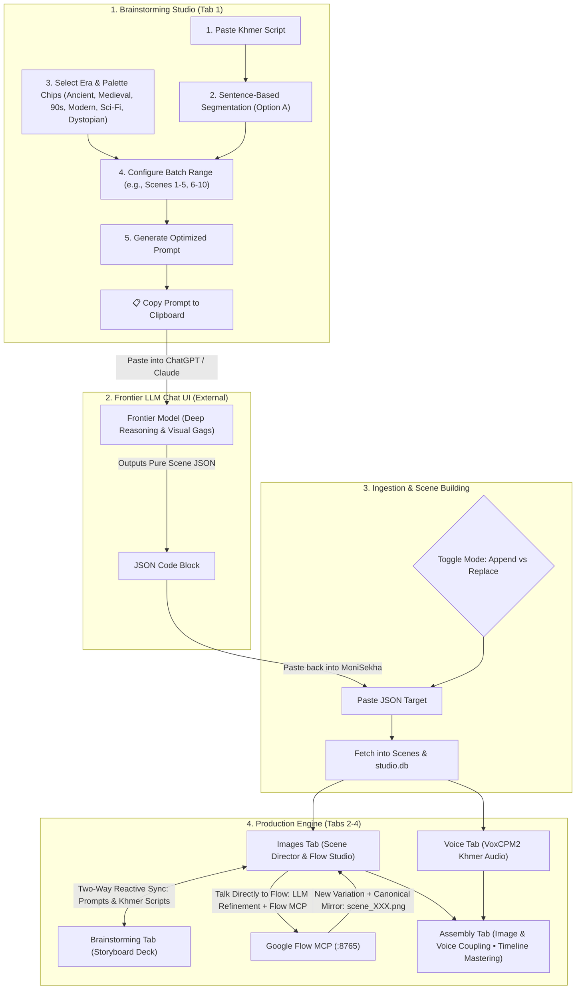
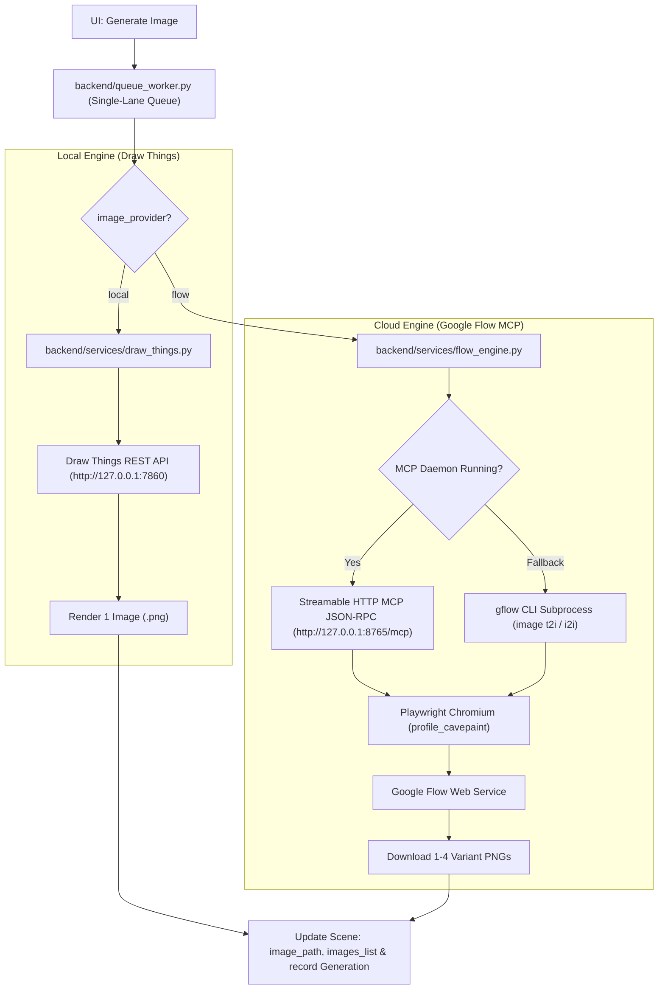

# MoniSekha (Video Studio) — System Architecture & Technical Overview

> **Target Audience**: AI Agents and Engineers continuing development or maintenance on this codebase.  
> **Database File**: `workspace/studio.db`  
> **Date Updated**: September 2026

---

## 1. Executive Summary & Mission

**MoniSekha** is an automated, local-first content creation studio and production pipeline that transforms raw research notes and ideas into fully synthesized, scene-by-scene audio-visual timelines.

### Primary Purpose & Visual Identity
The system is built to automate the creation of educational/explainer videos in the visual style of YouTube channels like **Whatly** and **Kurzgesagt**:
* **Visual Style**: Clean 2D flat vector editorial illustrations, bold clean outlines, vibrant flat solid colors, and diverse shot archetypes (educational diagrams/infographics, tool/object close-ups, wildlife, wide scale contrast, and selective dynamic character action). Prompts are concise and optimized specifically for local FLUX.1 models as well as Google Flow (Nano Banana 2 / Nano Banana Pro).
* **Audio / Script**: Cinematic narrative scripts written and synthesized entirely in **Khmer** with native sentence pacing and optional visual beat segmentation.
* **Pipeline Output**: Rendered high-resolution `.png` scene images paired with synchronized `.wav` or `.mp3` voiceover chunks and a concatenated `master_voiceover` timeline track, ready for Non-Linear Editors (NLEs) or FFmpeg rendering.

---

## 2. Brainstorming Pipeline: Human-in-the-Loop Frontier LLM Architecture

Instead of relying solely on generic background API calls, MoniSekha utilizes a **Human-in-the-Loop Prompt & Batching Bridge** to harness the superior creative storytelling and visual reasoning of web-based frontier models (e.g. Claude 3.7 Sonnet / ChatGPT o3).



---

## 3. Technology Stack & Key Dependencies

### Frontend (`frontend/`)
* **Framework**: Next.js 16.2.7 (App Router, Turbopack enabled).
* **React Core**: React 19.2.4 & React-DOM 19.2.4.
* **Styling**: Tailwind CSS v4 (`@tailwindcss/postcss`).
* **Icons**: `lucide-react` (^1.17.0).
* **Language**: TypeScript 5.

### Backend (`backend/`)
* **Web Framework**: FastAPI 0.111.0, Uvicorn 0.30.1.
* **Database / ORM**: SQLite via SQLAlchemy >= 2.0.36.
* **Data Validation**: Pydantic >= 2.7.2.
* **LLM Clients**: `google-generativeai==0.8.4`, `groq>=0.9.0`.
* **Audio & Tensor Libraries**: `soundfile==0.12.1`, `numpy==1.26.4`, PyTorch (`torch.mps` / `torch.cuda`).
* **Local TTS Model**: `voxcpm` (`ravuthz/VoxCPM2-khmer`).
* **Cloud Image Generation & MCP**: `gflow-cli==0.73.2` (Streamable HTTP MCP daemon + Playwright Chromium).
* **Environment Loader**: `python-dotenv==1.0.1` (loads `.env` and `.env.local`).

### Runtime Architecture & Python Isolation
* **FastAPI Backend Runtime**: Python 3.10+ (e.g. Conda or venv) for FastAPI, PyTorch, and VoxCPM2.
* **Google Flow MCP Runtime**: Python 3.10+ with `gflow-cli`, Playwright Chromium, and the MCP HTTP daemon on port `8765`.
* **Communication**: The backend communicates with the Google Flow daemon via Streamable HTTP JSON-RPC (`http://127.0.0.1:8765/mcp`) with an automated subprocess CLI fallback (`gflow image t2i / i2i`).

---

## 4. Database Schema & Data Models (`backend/database.py`)

The SQLite database is stored persistently at `workspace/studio.db`. Automatic column migrations ensure non-destructive upgrades across versions.

### 1. `Project` Table
Represents a complete video production workspace.
* `id` (`Integer`, PK): Unique project ID.
* `title` (`String`): Project display name.
* `slug` (`String`, Unique): Filesystem folder identifier (e.g., `why-are-we-alive`).
* `raw_research` (`Text`): Source raw notes, articles, or research prompts.
* `video_concept` (`Text`): High-level cinematic direction and theme.
* `script_narrative` (`Text`): Full flowing narrative script in Khmer.
* `illustration_style` (`Text`): Global visual prompt directive (stickman style).
* `global_voice_style` (`Text`): Acoustic styling and voiceover directives.
* `structured_json_data` (`Text`): JSON-stringified array of scene definitions.
* `status` (`String`): Current status (`draft`, `generating`, `completed`).
* `master_audio_path` (`String`): Relative path to combined audio (`workspace/<slug>/master_voiceover.wav`).
* `voice_profile_tag` (`String`): Global voice seed styling prompt tag.
* `audio_format` (`String`): Audio container format (`wav` or `mp3`, default `wav`).
* `theme_era` (`String`): Selected video era (e.g. `ancient`, `medieval`, `90s`, `modern`, `scifi`, `dystopian`).
* `theme_region` (`String`): Selected cultural region & country (e.g. `cambodia`, `western`, `east_asia`, `south_asia`, `middle_east`, `global`).
* `theme_mood` (`String`): Selected backdrop palette (e.g. `pure_white`, `pale_ice`, `parchment_cream`, `muted_sand`, `slate_navy`, `dark_crimson`).
* `theme_custom` (`Text`): Specific environmental props and detail notes.
* `aspect_ratio` (`String`): Target video aspect ratio (`16:9`, `9:16`, `1:1`, `4:3`, `2:3`, default `16:9`).
* `character_attire` (`Text`): Era-appropriate clothing and hairstyle instructions (Whatly style).
* `scene_staging` (`String`): Staging mode (`studio` for grounded white backdrop or `environment` for full-bleed scenery).
* `flow_project_id` (`String`, Nullable): Unique Google Flow cloud project ID tied to this MoniSekha project (1 MoniSekha project = 1 Flow project ID, preventing Google anti-bot triggers).
* `timeline_data` (`Text`, Nullable): JSON-stringified timeline state (BGM start offsets, volume, ducking flags, text overlays with fonts/colors/timing, and per-scene voice volume overrides).
* `scenes`: Relationship to `Scene` records with cascade delete.

### 2. `Scene` Table
Represents an individual slice/shot in the video timeline.
* `id` (`Integer`, PK): Unique scene ID.
* `project_id` (`Integer`, FK -> `projects.id`): Parent project link.
* `scene_number` (`Integer`): Sequential order in the timeline (1-based).
* `narration_khmer` (`Text`): Voiceover sentence in Khmer for this scene.
* `image_prompt_english` (`Text`): Positive Stable Diffusion prompt in English.
* `negative_prompt` (`Text`): Negative Stable Diffusion prompt constraints.
* `user_refinement_prompt` (`Text`): Natural language prompt edit history.
* `image_path` (`String`): Relative path to the currently selected active rendered image (e.g., `<slug>/scene_001_v01_1741912345.png`).
* `images_list` (`Text`, Nullable): JSON-stringified array of relative paths for all generated variations or uploaded assets (e.g., `["<slug>/scene_001_v01_1741912345.png", "<slug>/scene_001_v02_1741912450.png"]`).
* **Canonical Video Editing Mirror**: To ensure downstream video editing tools (Remotion, FFmpeg, CapCut automation) can deterministically bind timeline shots without parsing variant timestamps, the backend automatically copies/mirrors the active variation to `workspace/<slug>/scene_{scene_number:03d}.png` whenever an image is generated, uploaded, or set active.
* `reference_images` (`Text`, Nullable): JSON-stringified array of relative paths for reference images attached to this scene for conditioning.
* `image_status` (`String`): `idle`, `processing`, `completed`, or `failed`.
* `audio_path` (`String`): Relative path to scene audio (e.g., `<slug>/scene_001.wav`).
* `audio_status` (`String`): `idle`, `processing`, `completed`, `failed`, or `outdated`.
* `character_id` (`Integer`, FK -> `characters.id`, Optional): Voice profile assigned.
* `character_name` (`String`, Optional): Cached display name of character.

### 3. `Generation` Table
Audit trail and variant history tracking every image synthesis run across local and cloud providers.
* `id` (`Integer`, PK): Unique generation record ID.
* `scene_id` (`Integer`, FK -> `scenes.id`): Parent scene link.
* `provider` (`String`): Synthesis engine used (`draw_things` or `flow`).
* `model` (`String`): Model identifier (e.g., `flux`, `nano2`, `nano-pro`).
* `prompt` (`Text`): Exact positive prompt used for this generation run.
* `image_path` (`String`): Relative filesystem path to the generated image file.
* `parameters` (`Text`, Nullable): JSON-stringified parameter bundle (aspect ratio, steps, batch count, reference image paths, flow project ID).
* `created_at` (`DateTime`): Timestamp of creation.

### 4. `Character` Table
Global library of voice profiles across all projects.
* `id` (`Integer`, PK): Unique character ID.
* `name` (`String`): Display name.
* `gender` (`String`): `male` or `female`.
* `personality_tag` (`String`): Voice audition prompt (e.g., `[calm, deep, authoritative]`).
* `audio_path` (`String`): Path to reference `.wav` (`workspace/shared_characters/` or `custom_voices/`).
* `reference_text` (`String`): The exact transcription of the reference audio for zero-shot cloning.

### 5. `Setting` Table
Application-wide configuration (single row).
* `active_provider` (`String`): Active LLM provider (`gemini` or `groq`).
* `active_slot` (`Integer`): Active API key slot (`1` or `2`).
* `image_provider` (`String`, default `'local'`): Active image synthesis engine (`'local'` for Draw Things or `'flow'` for Google Flow MCP).

---

## 5. Subsystems & Execution Logic

### 5.1 Single-Lane Sequential Worker (`backend/queue_worker.py`)
* Processes tasks strictly **one-at-a-time** using an `asyncio.Queue` background loop.
* **Why Sequential?**
  1. Prevents VRAM exhaustion and GPU out-of-memory crashes between Draw Things and VoxCPM2 on Apple Silicon unified memory.
  2. Protects Google Flow's Playwright Chromium user profile directory (`profile_cavepaint`) from concurrent browser lockouts.
* **Task Routing**:
  * `image`: Dispatches to `FlowEngine.generate()` if `image_provider == 'flow'` (or task-specified), otherwise to `draw_things.generate_image()`. Automatically logs a `Generation` audit record, updates `scene.images_list`, and updates `scene.image_path`.
  * `audio`: Bulk voiceover generation across all scenes in a project using VoxCPM2.
  * `audio_single`: Targeted voice generation or cloning for an individual scene.

### 5.2 Brainstorming Engine & Frontier Prompt Generator
The Brainstorming Studio integrates the following components:
1. **Script Segmentation**: Splits Khmer script by sentence termination tokens (`[។\n]+`).
2. **Theme & Setting Taxonomy**:
   * **Eras**: Ancient/Prehistoric, Medieval, 90s/Retro, Today/Modern, Future/Sci-Fi, Dystopian.
   * **Atmosphere/Backdrop Color**: Slate Navy, Warm Cream, Pale Ice Blue, Muted Sand, Dark Burgundy.
   * **Custom Flavor**: Specific props, attire, or environmental conditions.
3. **Chunking / Scene Batching**:
   * Generates prompts for discrete batches (e.g., Scenes 1–5, Scenes 6–10) with custom batch sizing to prevent model hallucination and preserve visual depth.
   * Injects strict JSON schema and anti-markdown instructions into the copied prompt.
4. **Scene Ingestion**:
   * Accepts pasted JSON arrays from the frontier chat UI.
   * Toggle between **Append** (adding new scenes sequentially) and **Replace All** (overwriting timeline).

### 5.3 Dual Image Synthesis Architecture



#### 5.3.1 Local Engine (`backend/services/draw_things.py`)
* Connects to the local Draw Things REST API (`http://127.0.0.1:7860/sdapi/v1/txt2img`).
* Supports aspect ratio mapping (16:9, 9:16, 1:1, 4:3, 2:3), steps, and CFG scale.
* Includes a PIL fallback placeholder if the local service is offline.

#### 5.3.2 Cloud Engine: Google Flow MCP (`backend/services/flow_engine.py`)
* Powered by `ffroliva/gflow-cli` (v0.73.2+).
* **Protocol**: Connects to the persistent daemon via Streamable HTTP MCP JSON-RPC (`http://127.0.0.1:8765/mcp`) using `tools/call` (`image_generate` or `generate_images`).
* **Subprocess CLI Fallback**: If the daemon is temporarily offline or unresponsive, automatically falls back to `gflow image t2i` or `gflow image i2i` using Python 3.13.
* **Project Isolation (Anti-Bot Pattern)**: One MoniSekha project is mapped to exactly one Google Flow project ID (`flow_project_id`). This preserves Google Flow's workspace continuity and avoids triggering bot-detection rate limits from rapid project creation.
* **Deterministic Refinement**: When refining a scene, MoniSekha passes the active image and attached reference images directly as conditioning inputs, rather than relying on fragile multi-turn conversational session states.
* **Batch Variant Generation**: Supports generating 1 to 4 images per run (`count` parameter).
* **Model Selection**: Supports `nano2` (Nano Banana 2) and `nano-pro` (Nano Banana Pro).
* **Manual Uploads & Variant Management**: Users can directly upload `.png`, `.jpg`, or `.webp` files, promote any variant to the active canvas, or promote any variant to a reference image.

#### 5.3.3 Talk Directly to Flow (Scene Copilot) & Prompt Change Architecture
To balance fast manual tweaks with creative AI direction, MoniSekha implements two distinct operational modes for prompt and script changes:

1. **Direct Manual Mode (Zero LLM / Direct DB Sync)**:
   * Next.js does **not** call any LLM or rephrase text when you edit text fields directly.
   * Modifying **Voiceover (Khmer)**, **Stickman Visual Prompt (English)**, or **Exclusions** in either the Images tab or Brainstorming tab auto-saves directly to SQLite via `PUT /api/scenes/{id}`.
   * `ProjectDataContext` maintains real-time state in memory, guaranteeing **instant two-way synchronization** between the Brainstorming tab and the Images tab without page reloads.

2. **Conversational Copilot Mode ("Talk Directly to Flow")**:
   * Designed for iterative scene adjustments (e.g. *"Make the mammoth friendly, put a stickman rider on top holding a torch, and update the voiceover to match"*).
   * **Execution Pipeline**:
     1. The user inputs natural language instructions into the Scene Copilot bar.
     2. Next.js dispatches `POST /api/scenes/{id}/flow-adjust` to the FastAPI backend (no client-side LLM calls).
     3. The backend orchestrator (`backend/services/llm/orchestrators/refinement.py`) queries the active provider (Gemini 2.5 Flash or Groq) with:
        * Current positive prompt (`image_prompt_english`)
        * Current Khmer narration (`narration_khmer`)
        * Current negative constraints (`negative_prompt`)
        * Global project parameters (Video concept, Era, Staging mode, Aspect ratio)
        * User's adjustment instruction
     4. The LLM produces a structured JSON output:
        * Refined stickman visual prompt adhering to 2D flat vector rules.
        * Harmonized Khmer voiceover matching the new action.
        * Updated negative constraints.
        * A 1-sentence plain English change summary.
     5. The backend commits these updates to `Scene` and parent `structured_json_data`, instantly broadcasting updates to both tabs.
     6. If `generate_image=True`, the backend immediately drops an image generation task into `queue_worker.py`, instructing Google Flow MCP to render a new variation using the refined prompt.
     7. The resulting file is saved as `scene_{scene_number:03d}_v{var:02d}_{ts}.png`, registered in `images_list`, set as `scene.image_path`, and mirrored to the canonical `scene_{scene_number:03d}.png`.

3. **Video Editing Automation Architecture**:
   * **Standardized Variations**: Every generation or upload is stored as `scene_{scene_number:03d}_v{var_num:02d}_{ts}.png` to prevent browser caching collisions and preserve timeline history.
   * **Canonical File Mirroring**: The currently selected active variation is automatically copied to `workspace/<slug>/scene_{scene_number:03d}.png`. Automated video editing tools (Remotion, FFmpeg, CapCut) can unconditionally load `scene_001.png`, `scene_002.png`, etc. without requiring timestamp parsing.
   * **Timeline Manifest (`structured_json_data`)**: The project JSON includes `scene_number`, `narration_khmer`, `image_prompt_english`, `negative_prompt`, `image_path`, and `audio_path` for seamless downstream timeline rendering.

### 5.4 Local Khmer Voice Engine (`backend/services/voice_engine.py`)
* Uses `ravuthz/VoxCPM2-khmer` with automatic 60-second idle VRAM unloading (`torch.mps.empty_cache()` / `torch.cuda.empty_cache()`).
* Injects sentence punctuation (`។`) and an acoustic silence cushion (0.20s).
* Concatenates individual chunks into `master_voiceover.<format>`.

### 5.5 Assembly & Multi-Track Video Synthesis Engine (`backend/services/render_engine.py`)
* **Image-Voice Coupling Matrix**:
  * Evaluates each scene dynamically:
    * 🟢 **Coupled & Ready**: Canonical image (`scene_XXX.png`) and audio (`scene_XXX.wav/mp3`) are both present. Scene duration is precisely determined by `soundfile.info(audio_path).duration`.
    * 🟡 **Missing Audio**: Frame exists, narration audio is pending or outdated.
    * 🟡 **Missing Image**: Audio is ready, visual frame has not yet been rendered.
    * 🔴 **Uncoupled**: Neither asset exists.
* **Background Music (BGM) & Audio Mixing**:
  * Upload custom `.mp3`, `.wav`, or `.m4a` music files to `workspace/<slug>/bgm/`.
  * Non-destructive multi-track mixing: start offset slider (`adelay`), volume control, duplicate/looping, and auto-ducking (smoothly attenuating BGM by -12dB during voiceover narration).
* **Text & Subtitle Overlays**:
  * Configurable text layers with font families (Universal Sans, Editorial Serif, Bold Impact, Khmer Sangam MN), custom text color, background pill highlighting, and placement (bottom third, center, top).
* **Dual-Layer Execution**:
  1. **Real-time In-Browser Preview**: HTML5 Canvas and synchronized audio playback without waiting for server rendering.
  2. **Automated FFmpeg Video Pipeline**: Uses bundled `imageio-ffmpeg` (FFmpeg 7.1 with `libx264`, `libfreetype`, `libass`) to stitch image durations, mix audio tracks, burn text overlays, and export crisp 1080p MP4s matching the project aspect ratio (`16:9`, `9:16`, `1:1`, etc.) to `workspace/<slug>/final_output.mp4`.

---

## 6. Complete API Reference

| Method | Endpoint | Description |
|---|---|---|
| `GET` | `/api/health` | Backend health check. |
| `GET` | `/api/flow/status` | Google Flow daemon connectivity and CLI availability status. |
| `GET` | `/api/settings` | Retrieve active LLM provider, slot, and `image_provider` (`local` \| `flow`). |
| `PUT` | `/api/settings` | Update active LLM provider, slot, or `image_provider`. |
| `GET` | `/api/projects` | List all projects. |
| `GET` | `/api/projects/summary` | List projects with scene counts and completion stats. |
| `POST` | `/api/projects` | Create a new project. |
| `GET` | `/api/projects/{id}` | Get project details (with auto-healing filesystem validation). |
| `PUT` | `/api/projects/{id}` | Update project fields. |
| `DELETE` | `/api/projects/{id}` | Delete project and its workspace folder. |
| `POST` | `/api/projects/{id}/duplicate` | Duplicate project and copy scene definitions. |
| `POST` | `/api/projects/{id}/segment-script` | Programmatically split Khmer script by `។` and newlines into scenes. |
| `POST` | `/api/projects/{id}/import-scenes` | Ingest scenes from frontier LLM JSON (supports `append` or `replace`). |
| `POST` | `/api/projects/{id}/reset-voice` | Clear all generated audio files and reset voice seed for project. |
| `PUT` | `/api/scenes/{id}` | Update scene prompts, narration, or notes. |
| `POST` | `/api/scenes/{id}/refine` | AI-rewrite image positive & negative prompts with user instructions. |
| `POST` | `/api/scenes/{id}/flow-adjust` | Scene Copilot: Refines English stickman prompt, adjusts Khmer voiceover via backend LLM, commits to SQLite (syncing Brainstorming tab), and enqueues Google Flow MCP generation. |
| `POST` | `/api/scenes/{id}/generate-image` | Enqueue image generation task (accepts optional `?model=nano2&count=1`). |
| `POST` | `/api/scenes/{id}/stop` | Interrupt active image generation. |
| `DELETE` | `/api/scenes/{id}/image` | Delete active scene image file and reset scene status. |
| `POST` | `/api/scenes/{id}/upload-image` | Direct manual image file upload (PNG/JPG/WEBP); adds to variants, mirrors to `scene_XXX.png`, and sets active. |
| `PUT` | `/api/scenes/{id}/set-active-image` | Promote a specific image variant to become primary `image_path` and mirror to canonical `scene_XXX.png`. |
| `DELETE` | `/api/scenes/{id}/image-variant` | Delete a specific variant file from disk, update `images_list`, and re-mirror active variant to `scene_XXX.png`. |
| `POST` | `/api/scenes/{id}/reference-image` | Upload a reference conditioning image for image-to-image synthesis. |
| `DELETE` | `/api/scenes/{id}/reference-image` | Remove a reference image from scene conditioning tray. |
| `POST` | `/api/scenes/{id}/generate-audio` | Enqueue single scene audio generation task. |
| `POST` | `/api/projects/{id}/generate-voice` | Enqueue audio generation for all scenes. |
| `POST` | `/api/projects/{id}/stop-voice` | Cancel all pending voice tasks for the project. |
| `GET` | `/api/characters` | List all saved voice cloning character profiles. |
| `POST` | `/api/characters` | Create a new character (supports upload or audition sample promotion). |
| `DELETE` | `/api/characters/{id}` | Delete a character profile and its audio file. |
| `POST` | `/api/characters/preview` | Generate an audition audio sample from personality tags. |
| `DELETE` | `/api/characters/preview` | Delete temporary audition sample. |
| `POST` | `/api/characters/preview-clone` | Test clone voice from an uploaded sample before saving. |
| `DELETE` | `/api/characters/preview-clone` | Delete temporary clone test audio. |
| `POST` | `/api/model/load` | Manually load VoxCPM2 into memory. |
| `POST` | `/api/model/unload` | Manually unload VoxCPM2 and free VRAM. |
| `GET` | `/api/model/status` | Check memory state of VoxCPM2. |
| `GET` | `/api/projects/{id}/assembly-status` | Get scene coupling readiness matrix, audio durations, BGM list, and render status. |
| `PUT` | `/api/projects/{id}/timeline` | Persist multi-track assembly state (BGM offset/volume/ducking, text overlays, scene voice volume). |
| `POST` | `/api/projects/{id}/upload-bgm` | Upload background music file (`.mp3`/`.wav`/`.m4a`) to project `bgm/` directory. |
| `DELETE` | `/api/projects/{id}/bgm/{filename}` | Delete a background music file from project `bgm/` directory. |
| `POST` | `/api/projects/{id}/render-video` | Enqueue background FFmpeg video rendering job. |
| `GET` | `/api/projects/{id}/render-status` | Check video rendering status, progress percentage, and output path. |
| `GET` | `/static/*` | Static file server mounting `workspace/` assets. |

---

## 7. Frontend Architecture & Studio Tabs

### 7.1 Context Hierarchy (`frontend/app/context/`)
* **`UIContext`**: Global UI preferences (theme, active tab, sidebar state).
* **`ProjectsListContext`**: Project directory list, creation, deletion, duplication.
* **`ProjectDataContext`**: Active project state, scene data, updates, and synchronization.
* **`ProjectContext`**: Unified facade hook combining all contexts.

### 7.2 Studio Production Tabs
1. **Brainstorming Tab (`BrainstormingTab.tsx`)**:
   * **Left Panel (Script & Theme Studio)**:
     * Khmer narrative script input textarea with live sentence counter.
     * Selectable Era chips (Ancient, Medieval, 90s, Modern, Sci-Fi, Dystopian).
     * Selectable Solid Background Tone chips (Deep Slate, Warm Cream, Pale Ice, Muted Sand, Crimson).
     * Custom environment flavor / prop notes.
     * Batch Range Controller (Scene batch size + Batch 1, Batch 2, etc. selector).
     * **"📋 Copy Frontier Prompt" Button**: Generates and copies the ready-to-use prompt for ChatGPT/Claude.
   * **Right Panel (Scene Ingestion & Storyboard Deck)**:
     * JSON Paste Target with syntax validator.
     * **Import Mode Toggle**: `[ Append ]` vs `[ Replace All ]`.
     * **"📥 Ingest into Timeline" Button**.
     * Live Storyboard Scene Cards showing Scene #, Khmer Line, and English Stickman Prompt with direct editing capabilities.
2. **Images Tab (`ImagesTab.tsx` — Unboxed 2-Column Architecture)**:
   * **Design Philosophy**: Replaces the cramped 3-column "boxes-in-boxes" layout with a clean, breathable 2-column workspace matching the visual language of the Brainstorming tab.
   * **Left Column: Scene Director & Copilot**:
     * **Scene Navigator Bar**: `< Scene #01 / 10 >` with status indicator (`✓` when rendered) and a horizontal strip of quick scene jump pills (`#01 ✓`, `#02 ✓`, `#03`...).
     * **Voiceover (Khmer)**: Unboxed auto-resizing textarea for the Khmer voiceover sentence. Auto-saves directly to SQLite and syncs to Brainstorming tab instantly.
     * **Stickman Visual Prompt (English)**: Unboxed monospace auto-resizing textarea for positive prompt. Auto-saves directly to SQLite and syncs to Brainstorming tab instantly.
     * **Exclusions (Negative Constraints)**: Collapsible accordion matching Brainstorming tab exclusions.
     * **Reference Images Shelf**: Inline tags with `+ Add Ref` uploader.
     * **"Talk Directly to Flow" (Scene Copilot)**: Dedicated natural language adjustment interface. Users type ideas (e.g. *"Add a torch to stickman, make mammoth friendly, and tweak voiceover"*); backend Gemini refines the prompt and Khmer script, updates both tabs, and instructs Google Flow MCP to render a new variation. Features `Adjust & Generate (Flow)` and `Refine Text Only` actions.
   * **Right Column: Render Studio & Variations**:
     * **Top Control Strip**: Sleek pill selectors matching Brainstorming tab (Aspect Ratio, Flow Model, Batch Count 1-4, Flow Daemon Online & Auth status, Engine switcher).
     * **Render Output Frame**: Clean viewport displaying the active scene frame with Lightbox zoom modal, drag-and-drop file upload, and animated generation progress.
     * **Variations Strip**: Horizontal gallery displaying all rendered and uploaded variants (`V1`, `V2`, `V3`...) for the active scene. Features an active checkmark ring, click-to-activate (which also mirrors to canonical `scene_XXX.png`), delete variant button, and pin-as-reference button.
     * **Action Footer**: Primary `Generate Frame (Flow)` and `Clear Frames` actions.
3. **Voice Tab (`VoiceTab.tsx` — Unboxed 2-Column Architecture)**:
   * **Design Philosophy**: Replaces legacy grid and nested boxes with a viewport-locked 2-column layout matching the visual language and reactive standards of the Brainstorming and Images tabs.
   * **Left Column: Voice & Character Studio (~390px)**:
     * **Segmented Tabs**: `Voice Factory`, `Character Library`, and `Full Script`.
     * **Voice Factory**: Features `AI Voice Design` (with chip grids for Gender, Age, Tone, Speed and auto-compiled seed directive) and `Custom Clone` (with drag-and-drop `.wav` upload and byte checking). Includes live audition sample generator with interactive waveform player and save-to-library flow.
     * **Character Library**: Filterable voice profile directory by gender, with inline audition play/pause, delete profile, and a 1-click **"Apply to All Scenes"** batch narrator assignment.
     * **Full Script**: Auto-resizing view/edit of narrative script in Khmer with live counter and scene sync.
   * **Right Column: Audio Timeline & Scene Director (Flex-1)**:
     * **Top Control Strip**: Audio readiness counter (`X/Y Audio Ready`), filter pills (`All`, `Ready`, `Pending`, `Outdated`), audio format toggle (`WAV` / `MP3`), VoxCPM2 engine status badge with 1-click load/unload toggle, and batch actions (`Generate All Lines`, `Stop`, `Clear All Audio`).
     * **Vertical Scene Timeline**: Chronological shot list with scene number, speaker badge with character assignment popover, status pills (`Ready`, `Synthesizing...`, `Outdated`, `Idle`), single-scene regeneration (`↻`), single-scene audio deletion (`DELETE /api/scenes/{id}/audio`), and auto-resizing Khmer narration with two-way reactive sync to Brainstorming and Images tabs.
     * **Inline Audio Players**: Native dark-mode sleek player with interactive seekbar, elapsed/duration time display, and mute controls.
     * **Master Timeline Output Footer**: Dedicated master audio player with full scrub bar, status indication, and direct export download button (`master_voiceover.wav` / `master_voiceover.mp3`).
   * **Automated Video Editing File Synchronization**:
     * Deterministic 1-to-1 canonical pairing: `workspace/<slug>/scene_XXX.png` <-> `workspace/<slug>/scene_XXX.wav` (or `.mp3`).
     * Automatic SQLite manifest synchronization (`structured_json_data`) on every audio chunk and master compilation.
     * Automatic change invalidation: modifying narration in any tab flags the corresponding scene audio as `outdated`.
4. **Assembly Tab (`AssemblyTab.tsx` — Unboxed 2-Column Architecture)**:
   * **Design Philosophy**: Elevates the final studio stage from a static preview list to an interactive, unified Assembly editor where visual picture frames and spoken dialogue tracks are synchronized, mixed, and mastered.
   * **Left Column: Image-Voice Coupling Scene Deck (~480px)**:
     * **Coupling Readiness Header**: Summary counter (`X/Y Coupled & Ready (Z%)`) with visual progress bar.
     * **Filter Pills**: Quick toggle between `All`, `Ready (Coupled)`, and `Missing Assets`.
     * **Scene Coupling Cards**:
       * Canonical frame thumbnail preview with jump link to Images tab if missing.
       * Khmer narration text snippet with jump link to Voice tab if missing.
       * Exact audio duration badge (e.g. `4.2s`) dynamically computed via `soundfile`.
       * Coupling status badge: `🟢 Coupled`, `🟡 Missing Audio`, `🟡 Missing Frame`, `🔴 Uncoupled`.
       * **Individual Scene Voice Volume Slider**: Fine-tune speech level (0% to 150%) per scene with 1-click reset.
       * Click-to-seek: Clicking any scene moves the interactive playhead directly to that scene's start timecode.
   * **Right Column: Interactive Player & Multi-Track Studio (Flex-1)**:
     * **Real-time Video Viewport Canvas**: Responsive video frame reflecting the active project aspect ratio (`16:9`, `9:16`, `1:1`, etc.) with instantaneous frame switching as the playhead advances.
     * **Interactive Subtitle / Text Renderer**: Overlays styled captions directly on top of the video canvas in real-time.
     * **Transport & Scrub Bar**: Play/Pause, restart (`↺`), timecode indicators (`MM:SS / MM:SS`), and smooth scrub slider.
     * **Background Music (BGM) Track**:
       * Drag & drop / file upload for `.mp3`, `.wav`, or `.m4a` music.
       * Start offset slider (`start_time`), master music volume slider (0-100%).
       * **Duplicate Button**: Clone BGM block down the timeline to loop or repeat.
       * **Auto-Ducking Switch**: Automatically lowers music volume by -12dB when narration speech is active.
     * **Text Overlay Track**:
       * `+ Add Text` at playhead position.
       * Font Family picker: Universal Sans (Arial), Editorial Serif (Georgia), Bold Title (Impact), Khmer Standard (Khmer Sangam MN / Kantumruy Pro).
       * Color Palette presets (White, Yellow, Cyan, Coral, Black) with background pill highlighting.
       * Vertical placement: Lower-Third (Subtitle), Center (Title), Top (Header).
       * Start time & duration sliders, duplicate block, and delete.
     * **Video Export Pipeline**:
       * Primary action: `Export Video (MP4)`.
       * Background FFmpeg rendering with real-time percentage progress bar.
       * Direct download action once rendered (`workspace/<slug>/final_output.mp4`).

### 7.3 Settings Modal (`Sidebar.tsx`)
* Configures global LLM provider (`gemini` or `groq`) and active key slot.
* Configures global **Image Synthesis Engine** (`Local (Draw Things)` or `Google Flow (MCP)`).

---

## 8. Directory & File Organization

```
video_studio/
├── AGENTS.md                   # Agent guidelines & Next.js warning
├── CLAUDE.md                   # Legacy engine specification notes
├── overview.md                 # THIS FILE (Comprehensive system documentation)
├── .env.local                  # Local API keys (Gemini & Groq)
│
├── scripts/
│   ├── start_flow_daemon.sh    # Launches persistent gflow serve daemon on port 8765
│   └── update_flow_mcp.sh      # Controlled pip upgrade script for gflow-cli
│
├── backend/
│   ├── main.py                 # FastAPI application, REST routers & lifecycle
│   ├── database.py             # SQLAlchemy models, SQLite connection & migrations
│   ├── queue_worker.py         # Asyncio sequential background worker
│   ├── requirements.txt        # Python pip dependencies
│   └── services/
│       ├── draw_things.py      # Draw Things REST API integration
│       ├── flow_engine.py      # Google Flow MCP client (Streamable HTTP + CLI fallback)
│       ├── voice_engine.py     # VoxCPM2 TTS, cloning, and VRAM manager
│       ├── render_engine.py    # FFmpeg video assembly, duration probing & BGM mixer
│       ├── llm_orchestrator.py # High-level field generation router
│       └── llm/
│           ├── client.py       # Multi-provider client (Gemini & Groq)
│           └── orchestrators/  # Dedicated prompt engineering logic
│               ├── concept.py
│               ├── illustration.py
│               ├── refinement.py
│               ├── script.py
│               ├── structure.py
│               └── vocal.py
│
├── frontend/
│   ├── package.json            # Next.js 16 dependencies
│   ├── app/
│   │   ├── layout.tsx          # Root layout with UI & ProjectsList providers
│   │   ├── page.tsx            # Welcome screen / redirect
│   │   ├── globals.css         # Global styling & custom scrollbars
│   │   ├── context/            # Split context architecture
│   │   │   ├── ProjectContext.tsx
│   │   │   ├── ProjectDataContext.tsx
│   │   │   ├── ProjectsListContext.tsx
│   │   │   ├── UIContext.tsx
│   │   │   └── types.ts
│   │   ├── components/
│   │   │   ├── shell/          # Sidebar (with Settings), ProjectHeader, WelcomeScreen
│   │   │   └── tabs/           # BrainstormingTab, ImagesTab, VoiceTab, AssemblyTab
│   │   └── projects/[id]/      # Dynamic project routing
│   │       ├── layout.tsx      # Project data provider & layout wrapper
│   │       ├── brainstorming/page.tsx
│   │       ├── images/page.tsx
│   │       ├── voice/page.tsx
│   │       ├── assembly/page.tsx
│   │       └── output/page.tsx # Backwards-compatible redirect to /assembly
│
└── workspace/                  # Physical disk asset storage (ignored by git)
    ├── studio.db               # SQLite database file
    ├── shared_characters/      # AI-generated character voice profiles
    ├── custom_voices/          # Uploaded reference voice WAVs
    └── <project-slug>/         # Project rendered images, voice chunks, bgm/, and final_output.mp4
```

---

## 9. Environment Setup & Execution Guide

### Prerequisites
1. **Python Environment for Backend**: Conda environment named `voice` (Python 3.10+):
   ```bash
   conda activate voice
   ```
2. **Python Environment for Google Flow MCP**: Python with `gflow-cli` and Playwright:
   ```bash
   pip install --upgrade gflow-cli
   playwright install chromium
   ```
3. **One-Time Google Flow Authentication**:
   Log in to Google Flow once to save session cookies into the dedicated profile:
   ```bash
   gflow auth login --profile cavepaint --browser chrome
   ```
4. **Node.js**: Node 18+ or 20+.
5. **Draw Things (Optional)**: If using local generation, install Draw Things on macOS with the HTTP REST API enabled in Settings (`Port 7860`).
6. **Environment Variables**: Create `.env.local` or `.env` in the project root:
   ```env
   GEMINI_KEY_1=your_gemini_api_key_here
   GEMINI_KEY_2=your_optional_backup_gemini_key
   GROQ_KEY_1=your_groq_api_key_here
   GROQ_KEY_2=your_optional_backup_groq_key
   ```

### Starting the Application Services
* **Step 1: Start Google Flow Daemon**:
  ```bash
  bash scripts/start_flow_daemon.sh
  ```
  *(Runs `gflow serve --host 127.0.0.1 --port 8765 --profile cavepaint` in the background).*
* **Step 2: Start Backend**:
  ```bash
  conda activate voice
  uvicorn backend.main:app --reload --port 8000
  ```
* **Step 3: Start Frontend**:
  ```bash
  cd frontend
  npm run dev
  ```
* Open your browser to `http://localhost:3000`.

### Upgrading Google Flow MCP
To upgrade `gflow-cli` safely without breaking Python dependencies:
```bash
bash scripts/update_flow_mcp.sh
```

---

## 10. Developer Gotchas & Critical Guidelines

1. **Google Flow Anti-Bot Heuristics**:
   Always maintain **1 MoniSekha project = 1 Google Flow project ID (`flow_project_id`)**. Never create a new Flow project per scene. Rapid project creation triggers Google bot detection and captcha challenges.
2. **Playwright Chromium Profile Lock**:
   `gflow-cli` uses an exclusive lock on its user profile directory (`profile_cavepaint`). Do not run multiple concurrent `gflow` processes using the same profile. MoniSekha's single-lane sequential worker (`queue_worker.py`) guarantees serial execution.
3. **Python Runtime Isolation**:
   Do **not** attempt to install `gflow-cli` inside the `voice` Conda environment (Python 3.10). `gflow-cli` requires Python >= 3.11, while VoxCPM2/PyTorch dependencies in `voice` require Python 3.10. Keep them isolated via the HTTP daemon on port `8765`.
4. **Next.js 16 Dynamic Route Parameters**:
   In Next.js 16 App Router, `params` in layout components is a `Promise`. It **must** be unwrapped using React's `use(params)` before accessing properties (e.g., `const { id } = use(params);`).
5. **GPU Concurrency Lockout**:
   Never bypass the `task_queue` in `queue_worker.py` to run model generation concurrently in threads. Concurrent execution of Draw Things and VoxCPM2 on macOS Unified Memory causes heavy paging or kernel panic.
6. **Khmer Script Termination**:
   Khmer sentences must terminate with the special character `។`. The voice engine checks and enforces this before inference to ensure correct cadence and intonation.
7. **SQLite JSON Synchronization**:
   Whenever a scene's prompt, narration, or order is updated via `/api/scenes/{id}`, the helper function `sync_project_json` is invoked to synchronize the changes back into the parent project's `structured_json_data` column.
8. **Asset URL Resolution**:
   Assets stored under `workspace/<slug>/` are referenced in the database as relative paths (e.g. `my-project/scene_001.png`). The frontend converts these to URLs using `http://localhost:8000/static/<filename>`.
